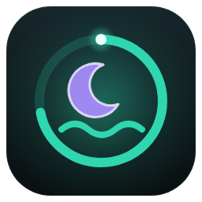

# Mental Health and Health Improvements for HAOS by Kilian K.

🇬🇧 [English version](README.md) · 🇩🇪 Deutsch

Ein persönlicher Stimmungs-, Journal-, Schlaf-, Gewichts-, Zyklus- und Trainingsbegleiter für **jede Person im Haushalt** – mit Familienansicht, eigenem kleinen lokalen Lernmodell und optionaler LLM-Anbindung (Beta). Kurze Check-ins morgens und abends, eine Schlaferkennung, die aus deinem Bettsensor lernt, sanfte Einblicke, was dir guttut – privat, lokal und komplett über die Oberfläche eingerichtet.

Läuft auf **jeder Home-Assistant-Installationsart** (Home Assistant OS, Container, Supervised, Core) – „HAOS“ steht nur im Namen.

> **Kein Medizinprodukt.** Schlaf-Score, Gewichts-Optimum, Stimmungs- und Zyklusprognose sind Orientierung, keine Diagnose. **Die Zyklusprognose ist keine Verhütungsmethode.** Wenn es dir nicht gut geht, sprich mit jemandem, dem du vertraust, oder melde dich bei der TelefonSeelsorge (0800 111 0 111 / 0800 111 0 222) bzw. der Nummer gegen Kummer (116 111).

---

## Funktionen

- **Check-ins morgens und abends in unter einer Minute** – Stimmungsregler mit einem Gesicht, das sich mit deiner Stimmung verändert, Energie, Gesundheitsgefühl, Schlafqualität, gute und nicht so gute Dinge, Vorsätze, Journal, Training, Gewicht, Periode. Wenige, klar markierte Pflichtfelder; was fehlt, wackelt kurz.
- **Benachrichtigungen pro Gerät** – öffnen direkt den Check-in. Auf **Android 14+** kommt eine weggewischte Meldung auf genau diesem Gerät zurück, solange dein Check-in offen ist. iOS nutzt „Dringende Mitteilungen“. Erinnerungen, „Später (10 min)“, sperrbildschirmtauglich (keine sensiblen Werte, außer du willst es).
- **Schlaferkennung, die dazulernt** – aus Bettsensoren (Druck, Spannung, Gewicht), An/Aus-Sensoren, Schlaf-Apps, Wearables, Handy-Signalen und mehr. Eine Zustandslogik über die Zeit statt eines einfachen Schwellwerts: Abends auf dem Bett sitzen ist kein Schlaf, neben der Messstelle schlafen schon. Im Morgen-Check-in bestätigst oder korrigierst du die Nacht per Ziehen – davon lernt das Modell am meisten.
- **Schlaf-Score und „Sleepmaxing“** – Score 0–100 mit Komponenten, `+6 %` ggü. deiner Woche und ggü. deinem persönlichen Optimum (gelernt aus deinem Befinden am nächsten Tag), farbig danach, ob du dich zum Optimum hin bewegst.
- **Stimmungsprognose** für heute mit Bandbreite und Begründung („weil du 2 Nächte unter 6 h geschlafen hast“), abends mit dem tatsächlichen Wert verglichen.
- **Health Score** pro Person und für die Familie, transparente Komponenten, Trend.
- **Insights** – Stimmungsverlauf (morgens/abends, Prognose vs. tatsächlich), Year in Pixels, Wochentage, Verteilung, Schlaf-Zeitleiste, Dauer ggü. Optimum, Gewichtstrend mit gesundem Bereich, Trainingsrhythmus, Zyklus, Zusammenhänge (Schlaf ↔ Stimmung, Training ↔ Energie), „Was dir gut tut / Was dich runterzieht“, Ziele-Tracker, Wochenrückblick und Monatsbericht, „Heute vor …“, Glücksglas.
- **Lokale KI-Suche** in eigenen Worten: *„schlechte Tage letzten Monat mit Training“*, *„gute Tage im Sommer“*, *„Wald“* – ein Regel-Parser macht daraus Filter-Chips, dazu Volltextsuche (BM25) mit Stammformen und Synonymen, Deutsch und Englisch.
- **Brain Dump** – eine To-do- und Gedankenliste mit bis zu drei Ebenen: Punkte im Morgen- und Abend-Check-in hinzufügen, abends Erledigtes abhaken (ein Haken gilt für alle Unterpunkte), die zwei ältesten und neuesten offenen Punkte auf „Heute“ und eine eigene Seite zum Sortieren, Bearbeiten und Löschen. Verschlüsselt wie das Journal.
- **Trainingsrhythmus** – zwei Ruhetage, Muskelkater-Abfrage, „Heute ist ein guter Tag für ein Training 💪“, hervorgehoben, wenn überfällig.
- **Gewicht** mit geglättetem Trend, Wochenschnitt und gesundem Optimum aus deiner Größe – mit verbindlichen Sicherheitsregeln (Abnehmen unter den gesunden Bereich wird nie gelobt, Kinder bekommen gar keine Wertung).
- **Zyklus** – Periode dokumentieren, gelernte Prognose (optional verfeinert über die Basaltemperatur), für Admins nur drei Sensoren sichtbar.
- **Geburtstage** – Alter, Countdown, Konfetti, mehrere am selben Tag, Daten ohne Jahr, 29. Februar.
- **Familienansicht** – Familien-„Wetter“ und Health Score ohne Namen und Einzelwerte, nur wenn genug Personen eingetragen haben.
- **Kindermodus** – wärmere Sprache, größere Bedienelemente, Emoji-Skala, „Bewegung“ statt Training, keine Gewichtswertung, kindgerechte Hilfeangebote.
- **Privatsphäre eingebaut** – Inhalte verschlüsselt gespeichert, nur die Person selbst liest ihre Einträge (auch Admins nicht), optionale persönliche PIN, die Texte zusätzlich kryptografisch schützt. Siehe [Privatsphäre](#privatsphäre).
- **Admin-Bereich im Panel** – Personen anlegen, Rechte, Module, Schlafquellen mit Live-Vorschau der letzten 48 h, Zeitpläne, Benachrichtigungsziele, Admin-PIN, Rechenlast, LLM-Beta, Backup & Wiederherstellen.
- **Backups** – Home-Assistant-Backups enthalten alles; zusätzlich eigene verschlüsselte `.mhbackup`-Dateien (manuell und automatisch) mit Vorschau und Sicherungspunkt vor jedem Wiederherstellen.
- **Optionale LLM-Funktionen (Beta)** über AI Task oder einen Konversations-Agenten von Home Assistant – nur nach Freigabe durch den Admin *und* eigener Zustimmung jeder Person.
- **Dashboard-Karten** für Personen-Übersicht, Familie, Check-in, Schlaf, Gewicht, Training, Stimmungsverlauf und Geburtstage – dazu ein Seitenleisten-Panel und eine Dashboard-Strategie.
- **Alles über die Oberfläche, alles lokal.** Standardmäßig Englisch, Deutsch wenn dein Home Assistant Deutsch spricht.

## Privatsphäre

Bitte ehrlich lesen – es ist ein Familiensystem, und Admins sind meist selbst Familienmitglieder.

- **Wer sieht was.** Nur die Person selbst sieht ihre Einträge, Journal, guten/schlechten Dinge, Ziele, Gewichtsverlauf (bei Live-Tracking), Zyklus-Details und persönlichen Auswertungen. **Admin-Rechte geben keinen Zugriff auf fremde Inhalte** – jeder Websocket-Befehl, der Inhalte liefert, prüft, dass der angemeldete Benutzer *diese* Person ist. Admins verwalten die Konfiguration und sehen den Modellzustand jeder Person ohne Inhalte.
- **Sensoren.** Admins sehen die Sensoren aller Personen (Stimmung heute, Schlaf-Score, Trainingsstatus, drei Zyklus-Sensoren: nächster Beginn, nächstes Ende, Periode aktiv …) – sie werden für Automationen gebraucht. In der Personenansicht zeigt die Integration nie fremde Sensoren. Home Assistant kann Entitäten vor Nicht-Admins nicht vollständig verstecken: Wer sie in ein Dashboard packt, sieht sie.
- **Nicht im Event-Bus.** Einträge landen nie in Entitäten, Attributen, Logbuch, Recorder oder Events. Benachrichtigungen tragen keine Antworten (keine Texteingabe) – sie öffnen nur die Check-in-Seite.
- **Verschlüsselt gespeichert.** Jede Person hat einen eigenen Store (`.storage/mental_health.person.<id>`). Zahlen sind mit einem Datenschlüssel der Person verschlüsselt, Texte mit einem eigenen Textschlüssel (Fernet/AES über das Paket `cryptography`, das Home Assistant ohnehin mitbringt). Die Schlüssel sind mit einem Master-Schlüssel in `.storage/mental_health.keys` umhüllt.
- **Persönliche PIN (optional).** Mit PIN wird der Textschlüssel **nur** mit einem aus der PIN abgeleiteten Schlüssel umhüllt (scrypt). Ohne PIN kann niemand die Texte entschlüsseln – auch kein Admin mit Dateizugriff. Zahlen (Stimmung, Schlaf …) bleiben für den Server lesbar, damit Sensoren und Prognosen weiterlaufen; die Textanalyse läuft nach dem Entsperren. **PIN vergessen?** Ein Admin kann sie zurücksetzen – die mit der PIN geschützten Texte sind dann endgültig verloren, Zahlen bleiben. Der Admin-Bereich zeigt das vorher deutlich an.
- **Ehrliche Grenzen.** Ein Admin mit Dateisystem- oder Code-Zugriff *und* dem Master-Schlüssel (der in Home-Assistant-Backups und in den eigenen Backups enthalten ist) kann technisch alles entschlüsseln, was nicht PIN-geschützt ist – und könnte den Code ändern. Die Trennung schützt in der Oberfläche; die Verschlüsselung schützt vor dem Durchklicken der Dateien und vor Kopien der Datendateien ohne Schlüssel. Home Assistant verschlüsselt seine Backups selbst. Python kann Schlüssel nicht zuverlässig aus dem Speicher löschen.
- **Diagnose und Logs** enthalten keine Inhalte – nur Struktur, Zähler, Modellzustand und Versionen.
- **LLM-Beta** sendet Ausschnitte deiner Einträge an den gewählten Agenten – nur mit Admin-Freigabe *und* deiner eigenen Zustimmung (jederzeit widerrufbar; Kinder standardmäßig gesperrt). Namen anderer Haushaltsmitglieder werden ersetzt. Ist der Agent ein Cloud-Dienst, verlassen diese Texte dein Zuhause.

Mehr: [docs/privacy.md](docs/privacy.md) (Englisch).

## Voraussetzungen

- Home Assistant **2025.1** oder neuer (LLM-Funktionen: AI Task ab **2025.8**, sonst ein Konversations-Agent).
- Personen (`person.*`) **mit verknüpftem Home-Assistant-Benutzer** – nur sie können teilnehmen.
- Für Benachrichtigungen: die Home Assistant **Companion App** (Android/iOS) oder ein beliebiger notify-Dienst, eine Notify-Entität oder ein Skript.
- Optional: Schlafquellen (siehe [Schlafquellen](#schlafquellen)), eine Waage bzw. ein Gewichtssensor, ein Basaltemperatur-Sensor.
- Das Integrations-Icon zeigt Home Assistant ab **2026.3**.

## Installation

### Home Assistant 2026.11 oder neuer: Marketplace

1. **Einstellungen → Marketplace → „Add from link“** und `https://github.com/kilian-haos/Mental-Health-and-Health-Improvements-for-HAOS-by-Kilian-K.` eintragen (beim ersten Mal GitHub verbinden, nur Lesezugriff).
2. **Mental Health and Health Improvements for HAOS by Kilian K.** installieren und Home Assistant neu starten (eine Reparaturmeldung bietet den Neustart an).

### Home Assistant 2026.10 oder älter: HACS (benutzerdefiniertes Repository)

1. **HACS → ⋮ → Benutzerdefinierte Repositories**, Repository-URL wie oben, Kategorie **Integration**.
2. Installieren, dann Home Assistant neu starten.

### Manuell

`custom_components/mental_health` nach `<config>/custom_components/` kopieren und Home Assistant neu starten.

## Einrichtung

1. **Einstellungen → Geräte & Dienste → Integration hinzufügen → Mental Health.** Ein Klick – das Seitenleisten-Panel **Mental Health** erscheint.
2. Panel öffnen → **Admin** → **Personen** → *Einrichten* neben einer Person. Ein kurzer Assistent fragt Name, Geburtsdatum, Geschlecht, **Kindermodus** und **„Darf eigene Daten bearbeiten“**, dann die Module.
3. Pro Person (im Admin-Bereich oder je nach Recht von der Person selbst): Benachrichtigungsziele (+ **Testbenachrichtigung**), Check-in-Zeiten, Schlafquellen, Gewichts- und Zyklus-Optionen.
4. Noch nicht eingerichtete Personen sehen eine Vorschau mit **„Einrichtung anfragen“** – Admins bekommen eine Benachrichtigung (oder eine Home-Assistant-Mitteilung, wenn kein Admin-Ziel eingestellt ist).

### Rechte

| | Admin | Erwachsene mit Bearbeitungsrecht | Erwachsene ohne | Kind |
|---|---|---|---|---|
| Personen anlegen/löschen, Kindermodus, Bearbeitungsrecht | ✅ | – | – | – |
| Profildaten (Alter, Geschlecht, Größe, Quellen …) | alle | eigene | eigene (ausgegraut) | eigene (ausgegraut) |
| Gewicht (Profilwert) | solange Live-Tracking aus ist | eigenes | eigenes (sehen) | eigenes (sehen) |
| Module | alle | eigene | ausgegraut | ausgegraut |
| Check-in-Zeiten und Pause | alle | eigene | eigene | nur sehen |
| Persönliche PIN | – (nur zurücksetzen) | ✅ | ✅ | ✅ |
| Einträge, Journal, Insights, Zyklus-Details | **nur eigene** | nur eigene | nur eigene | nur eigene |

Was jemand nicht ändern darf, ist ausgegraut mit kurzem Grund – nie versteckt. Eine optionale **Admin-PIN** (4-stellig, standardmäßig aus) schützt den Admin-Bereich; sie ist völlig getrennt von den Personen-PINs. Es gibt **ein PIN-Feld** (🔑): Die persönliche PIN eines Admins öffnet auch den Admin-Bereich; wird *stattdessen* die Admin-PIN eingegeben, gibt es Admin-Rechte nur für die aktuelle Sitzung – auch für Nicht-Admins, erkennbar am Hinweis „Als Admin drin“. Die Admin-PIN entschlüsselt nie die Texte einer Person.

## Check-ins

- **Morgens**: Begrüßung mit Stimmungsprognose, deine Nacht (bestätigen / per Ziehen korrigieren), Sleepmaxing, Gewichtshinweis, Stimmung (Pflicht), Energie, Schlafqualität, Gesundheitsgefühl, Muskelkater (wenn relevant), Trainingsempfehlung, Periode, Vorsätze von gestern, Geburtstage.
- **Brain Dump** (beide): neue Punkte hinzufügen (optional); abends zusätzlich eine aufklappbare Liste zum Abhaken offener Punkte.
- **Abends**: Stimmung (Pflicht), Energie, Gesundheitsgefühl, 1–3 gute Dinge (mind. 1), 1–2 nicht so gute (mind. 1), Vorsätze, Journal, Training ja/nein (Pflicht), Gewicht (optional; nach 15 Tagen ohne Wert einmalig Pflicht – nie bei Kindern), Periode.
- Der **Abend-Eintrag geht ab 14:00** (einstellbar) jederzeit über das Dashboard, der Morgen-Eintrag bis 14:00. Ein manueller Eintrag schließt eine offene Abfrage und entfernt ihre Benachrichtigung.
- **Antwortfenster** standardmäßig 60 min, danach „verpasst“; Nachtragen ist standardmäßig bis Tagesende erlaubt (markiert „nachgetragen“). Einträge lassen sich später bearbeiten und löschen; Statistik und Modelle rechnen nach.
- Ein Tag endet an der **Tagesgrenze** (Standard 04:00), nicht um Mitternacht.
- **Entwürfe** werden beim Tippen verschlüsselt auf dem Server zwischengespeichert – App schließen kostet nichts.
- **Pause** (Urlaub, krank): keine Abfragen, Serien reißen nicht, Prognosen pausieren – mit Enddatum oder unbegrenzt.

### Auslöser (pro Person, getrennt für morgens und abends)

1. **Uhrzeit** – eine Zeit für jeden Tag oder pro Wochentag (Standard 07:30 / 21:00).
2. **Zeitstempel-Entität** + Versatz (z. B. der nächste Wecker des Handys, ein Kalender).
3. **Schlaf** (mit Schlafquelle): morgens ≈ *Abstand* nach dem Aufstehen, abends ≈ 1,5 × *Abstand* vor dem vorhergesagten Zubettgehen. Ein Einstellwert, **Abstand zum Schlaf** (Standard 20 min); der tatsächliche Versatz wird anhand deiner Antwortzeiten verfeinert. Bei unsicherer Erkennung gilt die feste Uhrzeit.
4. **Manuell** – nur von Hand oder per Automation (Dienst `mental_health.start_checkin`, Button-Entitäten).

## Benachrichtigungen

Jedes Gerät wird einzeln benachrichtigt – ein defektes Ziel blockiert die anderen nicht. Erinnerungen (Standard alle 15 min) kommen mit Ton, bis der Check-in erledigt oder das Fenster vorbei ist; auf Android kommt eine weggewischte Meldung sofort zurück, solange das Fenster offen ist. Die Meldung öffnet `/mental-health?checkin=morning|evening`, dazu die Aktion „Jetzt eintragen“ und optional „Später (10 min)“. **Keine Texteingabe in Benachrichtigungen** (Antworten liefen über den Event-Bus und den Recorder).

### Persistente Benachrichtigungen auf Android 14+

Ab **Android 14** lassen sich auch Benachrichtigungen mit `persistent: true` wegwischen. Android verhindert das nur noch bei gesperrtem Bildschirm und in wenigen Systemfällen – eine wirklich feste Benachrichtigung gibt es nicht mehr.

**Die Lösung in Mental Health:** Wird eine Check-in-Meldung weggewischt, sendet die Integration sie **sofort erneut – nur an das Gerät, auf dem sie weggewischt wurde, und nur, solange dein Check-in offen ist**. Dafür meldet die Companion App das Ereignis `mobile_app_notification_cleared`. Welches Gerät es war, steckt im Tag der Meldung (`mh_<person>_<morgens|abends>_<gerät>`), nicht im sichtbaren Text. Erneutes Senden ist begrenzt (höchstens alle 10 s, höchstens 20-mal pro Fenster) und lautlos (`alert_once`). Ist der Check-in erledigt oder abgelaufen, werden die Meldungen auf allen Geräten entfernt. Du brauchst dafür **keine eigene Automation**.

**Einstellungen in der Companion App (Android):**
- Benachrichtigungen erlauben und **Benachrichtigungszugriff** erteilen.
- **Akku: „Nicht eingeschränkt“** – sonst kommt das Wegwisch-Ereignis nicht zuverlässig an.
- Ton, Wichtigkeit und Anzeige auf dem Sperrbildschirm stellst du pro Kanal **„Mental Health – Check-in“** in den Android-Einstellungen ein.

**iOS / macOS:** Feste Benachrichtigungen gibt es dort nicht. Mental Health nutzt die Stufe **„time-sensitive“** (in den iOS-Einstellungen für die Home-Assistant-App „Dringende Mitteilungen“ erlauben), ersetzt die Meldung über ihren Tag und erinnert, solange der Check-in offen ist.

**Andere Ziele** (Notify-Entitäten, Telegram, Skripte wie ein „Push an ein Gerät“-Skript mit frei zuordenbaren Feldern) bekommen Text und Link, ohne Persistenz.

Im Profil gibt es eine Anleitung pro Plattform und den Knopf **„Testbenachrichtigung senden“**. Details (Englisch): [docs/notifications.md](docs/notifications.md).

## Schlafquellen

Jede Person kann mehrere Quellen haben, jede mit Rolle und Zuordnung. Du fügst sie im Profil hinzu – der Assistent zeigt die **letzten 48 h aus dem Recorder mit der Erkennung des Modells darüber**; bei numerischen Quellen ist die gelernte bzw. eingegebene Schwelle eine **ziehbare Linie**.

| Art | Beispiele | Zuordnung |
|---|---|---|
| An/Aus | Bettsensor, Druckmatte, `input_boolean`, iPhone-Fokus „Schlafen“ | ob `an` oder `aus` im Bett / schläft bedeutet |
| Numerisch | Druck, Kraft, Spannung (z. B. ein ESPHome-Bettsensor), Gewicht im Bett | optionales Triggerlevel + Richtung – leer = wird gelernt |
| Zustände | Sleep as Android, Wearables, `sensor.<handy>_sleep_segment` | Zustände schläft/wach/im Bett zuordnen (mit Vorschlägen) |
| Wahrscheinlichkeit | `sensor.<handy>_sleep_confidence` (0–100) | direkt als Signal |
| Hilfssignale | Handy lädt, Display an, Licht im Schlafzimmer, Bewegung anderswo, Präsenz im Schlafzimmer, zuhause | schwache Belege, Gewichte werden gelernt |

Ein Sensor kann mehreren Personen gehören (**geteiltes Bett**): Das Modell lernt Niveaus für 0/1/2 Personen und unterscheidet über die Signale der einzelnen Personen, wer im Bett liegt – ehrlich mit geringerer Konfidenz, wenn es das nicht trennen kann.

### Beispiel: ESPHome-Bettsensor (Spannung)

```yaml
sensor:
  - platform: adc
    pin: GPIO34
    name: "Master Bed Sensor"
    attenuation: 12db
    update_interval: 5s
    filters:
      - sliding_window_moving_average:
          window_size: 6
          send_every: 1
```

Ein typisches Muster (Grundlinie ≈ 3,1 V bei leerem Bett, Einbrüche, wenn jemand auf der Messstelle liegt) wird auch dann gut erkannt, wenn man den Großteil der Nacht neben dem Sensor liegt – siehe [So funktioniert es](#so-funktioniert-es). Mehr (Englisch): [docs/sleep-sources.md](docs/sleep-sources.md).

## Dashboard-Karten, Panel und Strategie

Die Karten werden automatisch geladen – keine Ressource nötig. Jede Karte hat einen visuellen Editor und skaliert in Sections-Ansichten.

| Karte | Inhalt |
|---|---|
| `custom:mental-health-person-card` | Stimmung heute, Health Score, Schlaf + Sleepmaxing, Training, Check-in-Knopf |
| `custom:mental-health-family-card` | Familien-Wetter, Familien-Health-Score, Trend, Geburtstage |
| `custom:mental-health-checkin-card` | Check-in direkt im Dashboard (Tablets/Wanddisplays – der Eintrag gehört zum angemeldeten Benutzer) |
| `custom:mental-health-sleep-card` | letzte Nacht, Score, Sleepmaxing |
| `custom:mental-health-weight-card` | Trendlinie mit gesundem Bereich |
| `custom:mental-health-training-card` | Status und 4-Wochen-Rhythmus |
| `custom:mental-health-mood-chart-card` | Stimmung morgens/abends, Prognose, 7 Tage – 1 Jahr |
| `custom:mental-health-birthday-card` | nächste Geburtstage |

Alle Karten **zeigen immer nur die Daten des angemeldeten Benutzers**. Nicht eingerichtete Personen sehen eine Vorschau mit „Einrichtung anfragen“.

**Als Standard-Dashboard.** Das Seitenleisten-Panel `/mental-health` ist das vollständige persönliche Dashboard (Heute, Insights, Verlauf, Familie, Profil, Admin). Bietet deine Home-Assistant-Version eigene Panels nicht als Standard-Dashboard an, lege einmal (als Admin) ein Dashboard mit dieser Rohkonfiguration an – jede Person kann es dann als Standard wählen und sieht darin nur ihre eigenen Daten:

```yaml
strategy:
  type: custom:mental-health
```

## Entitäten

Ein Gerät pro Person („<Name> – Mental Health“) und ein Familien-Hub. Entitäten abgeschalteter Module werden nicht angelegt (bzw. aufgeräumt). Keine Texte in Zuständen oder Attributen.

- **Pro Person**: Stimmung morgens/abends/heute, Ø 7/30 Tage, Trend, Stimmungsprognose (+ Konfidenz), Energie, Gesundheitsgefühl, Schlafqualität, Health Score, Schlafzustand (`away`/`in_bed`/`asleep`/`nap`), schläft, im Bett, letzte Schlafdauer, Schlaf-Score, ggü. Woche %, ggü. Optimum %, optimale Schlafdauer, zuletzt eingeschlafen / aufgewacht, vorhergesagtes Zubettgehen / Aufstehen, Regelmäßigkeit, Konfidenz, Gewicht (nur ohne Live-Tracking) / Gewicht fällig / Tage seit Gewicht, Trainingsstatus / Tage seit Training / letzter Muskelkater / empfohlen / letztes Training, **Zyklus: nächster Beginn, nächstes Ende, Periode aktiv – sonst nichts**, Morgen/Abend-Check-in offen, nächste Check-ins, letzter Check-in, Serie, Alter, nächster Geburtstag, Geburtstag heute, Schalter **Pause**, Buttons **Morgen-/Abend-Check-in starten**.
- **Familien-Hub**: Familienstimmung heute / Ø 7 Tage / Trend, Familien-Health-Score, Familien-Schlaf-Score, Teilnahme, Geburtstage heute (Namen als Attribut), nächster Geburtstag, letztes Backup, Rechenlast, Schalter LLM-Beta, Button Backup erstellen.

## Dienste

| Dienst | Zweck |
|---|---|
| `mental_health.start_checkin` | Check-in für eine Person öffnen (`kind`: morning/evening, optional `window_minutes`) |
| `mental_health.cancel_checkin` | offene Check-ins schließen und Benachrichtigungen entfernen |
| `mental_health.pause_person` / `resume_person` | pausieren (optional `until`) / fortsetzen |
| `mental_health.create_backup` / `restore_backup` | eigene Backups (Admins) |
| `mental_health.request_setup` | Admins bitten, den aufrufenden Benutzer einzurichten |
| `mental_health.send_test_notification` | alle Ziele einer Person testen |

## Backup & Wiederherstellen

- **Home-Assistant-Backups** enthalten Mental Health automatisch (Stores in `.storage/`). Vor einem Backup schreibt die Integration alles weg und pausiert Schreibzugriffe währenddessen.
- **Eigene Backups** (Admin-Bereich): vollständiger Stand (Konfiguration, alle Personen-Stores mit weiterhin verschlüsselten Inhalten, Schlüsselmaterial, Modelle) als `.mhbackup` (JSON + gzip, mit einem **Backup-Passwort** verschlüsselt – ohne Passwort kein Export). Wer Datei *und* Passwort hat, kann wiederherstellen. Automatische Backups täglich oder wöchentlich nach `<config>/mental_health/backups/`, Anzahl einstellbar.
- **Löschen** einzelner Backup-Dateien im Admin-Bereich (mit Bestätigung). Automatische Backups werden auf die eingestellte Anzahl begrenzt; manuelle bleiben, bis du sie löschst.
- **Wiederherstellen**: Datei hochladen oder auswählen → Vorschau (Datum, Version, Personen, Umfang) → **vorher automatisch ein Sicherungspunkt des aktuellen Stands** → alles, nur Konfiguration oder nur eine Person → die Integration lädt neu. Ältere Backup-Formate werden migriert.
- **Persönlicher Export** (nur die Person selbst): eigene Daten als JSON oder Markdown; eigenes JSON lässt sich wieder importieren.

## Sprache

- Dialoge, Entitätsnamen, Zustände und Dienste nutzen die Übersetzungen von Home Assistant (Englisch und Deutsch; andere Sprachen fallen auf Englisch zurück).
- Karten und Panel folgen der Sprache des angemeldeten Benutzers (Deutsch oder Englisch).
- Texte, die die Integration selbst schreibt (Benachrichtigungen, Gerätemodelle, Panel-Titel), folgen der Systemsprache. Ändert sie sich, lädt die Integration neu.

## So funktioniert es

- **Schlaferkennung** – pro Minute liefert jeder Kanal Belege (Bettbelastung, Bewegung, Schlafhinweise, Handy-Display, Licht, Bewegung anderswo, Präsenz, zuhause), jeweils mit einer gelernten Wahrscheinlichkeit je Zustand (*weg*, *im Bett wach*, *schläft*) – ein kleines Naive-Bayes-Modell mit Beta-Zählern. Ein **gelernter Tageszeit-Prior** (48 Halbstunden) sorgt dafür, dass eine „ruhige Grundlinie“ zwischen Zubettgehen und Aufstehen als Schlaf zählt, solange nichts klar dagegen spricht. Vorwärts-Rückwärts über die Nacht liefert eine Wahrscheinlichkeit pro Minute; dann folgen Mindestdauern, Hysterese, kurze Wachphasen als Unterbrechungen, Nickerchen tagsüber und ein Anker am letzten Verlassen des Betts. Numerische Quellen bekommen **Grundlinie, Richtung und Niveaus aus einer Gauß-Mischung mit 2–3 Komponenten** (EM über ein verblassendes Histogramm – robust gegen Drift). Deine Bestätigungen und Korrekturen sind die stärksten Lernsignale; bis etwa 14 Nächte zeigt das Modell „lernt noch“ und fragt öfter nach.
- **Optimale Schlafdauer** – startet mit altersgerechten Empfehlungen (NSF 2015, AASM 2016) und wird aus deinem Befinden am Folgetag gelernt, immer innerhalb der Empfehlung.
- **Stimmungsprognose** – eine kleine Online-Ridge-Regression pro Person (Schlaf ggü. Optimum, Schlaf-Score, Wochentag, Trend, Training, Muskelkater, Zyklusphase, Werte von gestern, optional vom Admin freigegebene Temperatur/Tageslicht). Erscheint nach etwa 10 Tagen.
- **Textanalyse** – Themen über Schlüsselwörter, Stammformen und Synonymlisten plus gelernte Häufungen, eine lexikonbasierte Tönung, verknüpft mit deiner Stimmung. Alles lokal, Deutsch und Englisch.
- **Rechenlast 1–3** (Auswahl am Hub): wie oft die Live-Schlaferkennung läuft (alle 5 / 2 / 1 min) und wie gründlich der nächtliche Abgleich ist. Nächtliche Auswertung um 03:30 (einstellbar).

**Gemessene Last** (`tools/bench.py`, Mac, Python 3.14, 3 Jahre Daten pro Person, Bettsensor alle 5 s): Stufe 1 ≈ 0,03 %, **Stufe 2 (Standard) ≈ 0,07 %**, Stufe 3 ≈ 0,13 % eines CPU-Kerns pro Person im Tagesmittel – 10 Personen auf Stufe 2 ≈ 0,7 %. Speicher der Integration: ≈ 2,3 MB pro Person, **≈ 23 MB für 10 Personen mit je 3 Jahren Daten** (ohne den Grundbedarf von Home Assistant).

## Einstellungen

Admin-Bereich → Einstellungen: Tagesgrenze, Abend-Eintrag ab, Morgen-Eintrag bis, Antwortfenster, Erinnerungen, Nachtragen, Zeit der nächtlichen Auswertung, Rechenlast, Familienwerte ab (Personen, mind. 2), Schutzhinweis nach (Tagen) / mit Stimmung höchstens, Wochenrückblick-Benachrichtigung, Arbeitstag-Sensor, Außentemperatur und Tageslicht (optional, für die Prognose), Sperrzeit für Anfragen. Pro Person: Module, Zeiten, Abstand zum Schlaf, Benachrichtigungsverhalten, Dauer der PIN-Sitzung.

## Tipps

- Leg die **Personen-Karte** aufs Handy-Dashboard und nutze die Benachrichtigung – dann dauern die meisten Check-ins 30 Sekunden.
- Bestätige oder korrigiere in den ersten zwei Wochen deine Nacht – davon lernt das Schlafmodell am schnellsten.
- Ein geteiltes Bett klappt am besten, wenn jede Person die Lade- und Display-Sensoren ihres Handys als Hilfssignale hat.
- Für Wand-Tablets die **Check-in-Karte** nutzen, mit der Person, die auf dem Tablet angemeldet ist.

## Fehlersuche

- **Android-Meldung kommt nach dem Wegwischen nicht zurück**: Akku „Nicht eingeschränkt“ für die Companion App, Benachrichtigungszugriff erteilt, App aktuell. Testbenachrichtigung im Profil senden.
- **Schlaf zu früh/spät erkannt**: ein paarmal im Morgen-Check-in korrigieren; im Profil die Vorschau der Quelle prüfen (Schwellenlinie, Richtung).
- **„Gesperrt – PIN eingeben“**: deine persönliche PIN schützt die Ansicht; die Dauer der Sitzung stellst du im Profil ein.
- **Reparaturmeldung „… fehlt“**: eine Quelle oder ein Benachrichtigungsziel wurde entfernt – ein Klick entfernt den Verweis, Daten bleiben.
- **Neu anfangen**: Integration entfernen (löscht die Stores; eigene Backup-Dateien bleiben) und neu hinzufügen.
- **Protokolle / Diagnose**: Einstellungen → System → Protokolle; Geräte & Dienste → Mental Health → ⋮ → **Diagnose herunterladen** (ohne Inhalte).

## Hinweis

Diese Integration ist kein Medizinprodukt und gibt keine medizinischen Ratschläge. Schlaf-Score, Gewichts-Optimum, Prognosen und Zyklusprognose sind Orientierung anhand deiner eigenen Daten. **Die Zyklusprognose ist nicht zur Verhütung geeignet.** Bei starken Schmerzen, Unregelmäßigkeiten, ungewolltem Gewichtsverlust oder anhaltend gedrückter Stimmung bitte ärztlich abklären. TelefonSeelsorge 0800 111 0 111 / 0800 111 0 222, Nummer gegen Kummer 116 111 (Kinder und Jugendliche).

## Lizenz

**PolyForm Strict License 1.0.0** – Quelltext einsehbar, aber nicht Open Source. Du darfst die Integration für private und andere nicht-kommerzielle Zwecke installieren und nutzen (z. B. in deinem Home Assistant über Marketplace, HACS oder manuell). Weitergeben, verkaufen oder veränderte bzw. darauf aufbauende Versionen veröffentlichen ist nicht erlaubt. Siehe [LICENSE](LICENSE) (Englisch).

## Entwicklung

Siehe [README.md → Development](README.md#development).
