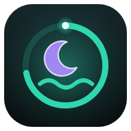

# Mental Health and Health Improvements for HAOS by Kilian K.

🇬🇧 English · 🇩🇪 [Deutsche Version](README.de.md)

A personal mood, journal, sleep, weight, cycle and training companion for **every person in your household** – with a family view, its own small local learning model and an optional LLM integration (beta). Short morning and evening check-ins, sleep detection that learns from your bed sensor, gentle insights about what does you good – private, local and fully configured through the user interface.

Works on **every Home Assistant installation type** (Home Assistant OS, Container, Supervised, Core) – "HAOS" is just in the name.

> **Not a medical device.** Sleep score, weight optimum, mood forecast and cycle forecast are orientation only, not a diagnosis. **The cycle forecast is not a contraceptive method.** If you are struggling, please talk to someone you trust or contact a local helpline.

---

## Features

- **Morning and evening check-ins in under a minute** – mood sliders with a face that changes with your mood, energy, feeling of health, sleep quality, good and not-so-good things, intentions, journal, training, weight, period. Mandatory fields are few and clearly marked; missing ones shake gently.
- **Smart notifications per device** – opens the check-in directly. On **Android 14+** a swiped-away notification comes back on exactly that device while your check-in is open. iOS uses time-sensitive notifications. Reminders, "later (10 min)", lock-screen friendly (no sensitive values unless you want them).
- **Sleep detection that learns** – from bed sensors (pressure, voltage, weight), on/off sensors, sleep apps, wearables, phone signals and more. A state model over time instead of a simple threshold: sitting on the bed in the evening is not sleep, sleeping beside the measuring point still is. Confirm or correct the night in the morning check-in by dragging – the model learns most from that.
- **Sleep score and "sleepmaxing"** – score 0–100 with components, `+6 %` vs. your week and vs. your personal optimum (learned from how you feel the next day), coloured by whether you move towards the optimum.
- **Mood forecast** for today with a range and an explanation ("because you slept 2 nights under 6 h"), compared with what really happened.
- **Health score** per person and for the family, transparent components, trend.
- **Insights** – mood chart (morning/evening, forecast vs. actual), year in pixels, weekdays, distribution, sleep timeline, duration vs. optimum, weight trend with healthy band, training rhythm, cycle, connections (sleep ↔ mood, training ↔ energy), "what does you good / what drags you down", goals tracker, weekly review and monthly report, "on this day", happiness jar.
- **Local "AI" search** in your own words: *"bad days last month with training"*, *"good days in summer"*, *"forest"* – a rule parser turns it into filter chips, full-text search (BM25) with stems and synonyms, German and English.
- **Training rhythm** – two rest days, muscle soreness check, "today is a good day for a workout 💪", highlighted when overdue.
- **Weight** with a smoothed trend, weekly average and a healthy optimum from your height – with binding safety rules (losing weight below the healthy range is never praised, children get no rating at all).
- **Cycle** – period documentation, learned forecast (optionally refined by basal temperature), only three sensors visible to admins.
- **Birthdays** – age, countdown, confetti, several people on the same day, dates without a year, 29 February.
- **Family view** – family "weather" and health score without names or single values, shown only when enough people have filled in.
- **Children's mode** – warmer language, larger controls, emoji scale, "exercise" instead of training, no weight rating, child-appropriate help offers.
- **Privacy built in** – contents are encrypted at rest, only the person can read their own entries (admins included), optional personal PIN that also protects texts cryptographically. See [Privacy](#privacy).
- **Admin area in the panel** – add persons, rights, modules, sleep sources with a live 48 h preview, schedules, notification targets, admin PIN, computing load, LLM beta, backup & restore.
- **Backups** – Home Assistant backups include everything; additionally own encrypted `.mhbackup` files (manual and automatic) with preview and a safety point before every restore.
- **Optional LLM features (beta)** via Home Assistant's AI task or a conversation agent – only after admin activation *and* each person's own consent.
- **Dashboard cards** for the person overview, family, check-in, sleep, weight, training, mood chart and birthdays – plus a sidebar panel and a dashboard strategy.
- **Everything through the UI, everything local.** English by default, German if your Home Assistant runs in German.

## Privacy

Please read this honestly – it is a family system, and admins are usually family members too.

- **Who sees what.** Only the person can see their entries, journal, good/bad things, goals, weight history (with live tracking), cycle details and personal analyses. **Admin rights do not grant access to anyone else's contents** – every websocket command that returns contents checks that the logged-in user *is* that person. Admins manage configuration and see the model state of each person without contents.
- **Sensors.** Admins can see the sensors of every person (mood today, sleep score, training status, three cycle sensors: next start, next end, period active …) – they are needed for automations. The integration never shows other people's sensors in a person's view. Home Assistant cannot fully hide entities from non-admins: anyone who puts them on a dashboard can see them.
- **Not in the event bus.** Entries are never written to entities, attributes, the logbook, the recorder or events. Notifications never carry answers (no reply text) – they only open the check-in page.
- **Encryption at rest.** Each person has their own store (`.storage/mental_health.person.<id>`). Numbers are encrypted with a person data key, texts with a separate text key (Fernet/AES via the `cryptography` package that ships with Home Assistant). The keys are wrapped with a master key in `.storage/mental_health.keys`.
- **Personal PIN (optional).** With a PIN, the text key is wrapped **only** with a key derived from the PIN (scrypt). Without the PIN nobody can decrypt the texts – not even an admin with file access. Numbers (mood, sleep …) stay readable for the server so sensors and forecasts keep working; text analysis runs after you unlock. **If you forget your PIN**, an admin can reset it – the PIN-protected texts are then lost for good; numbers are kept. The admin area shows this before resetting.
- **Honest limits.** An admin with file-system or code access, *and* the master key (which is part of Home Assistant backups and of the integration's own backups), can technically decrypt everything that is not PIN-protected – and could change the code. The separation protects in the user interface; the encryption protects against clicking through files and against copies of the data files without the key. Home Assistant encrypts its own backups. Python cannot reliably wipe keys from memory.
- **Diagnostics and logs** contain no contents – only structure, counters, model state and versions.
- **LLM beta** sends excerpts of your entries to the selected agent – only with admin activation *and* your own consent (revocable at any time; children locked by default). Names of other household members are replaced. If the agent is a cloud service, these texts leave your home.

More details: [docs/privacy.md](docs/privacy.md).

## Requirements

- Home Assistant **2025.1** or newer (LLM features: AI task from **2025.8**, otherwise a conversation agent).
- Persons (`person.*`) **with a linked Home Assistant user** – only they can take part.
- For notifications: the Home Assistant **Companion App** (Android/iOS) or any notify service/entity/script.
- Optional: sleep sources (see [Sleep sources](#sleep-sources)), a scale or weight sensor, a basal temperature sensor.
- The integration icon is shown from Home Assistant **2026.3** on.

## Installation

### Home Assistant 2026.11 or newer: Marketplace

1. **Settings → Marketplace → "Add from link"** and enter `https://github.com/kilian-haos/Mental-Health-and-Health-Improvements-for-HAOS-by-Kilian-K.` (connect GitHub once, read-only).
2. Install **Mental Health and Health Improvements for HAOS by Kilian K.** and restart Home Assistant (a repair notice offers the restart).

### Home Assistant 2026.10 or older: HACS (custom repository)

1. **HACS → ⋮ → Custom repositories**, repository URL as above, category **Integration**.
2. Install, then restart Home Assistant.

### Manual

Copy `custom_components/mental_health` into `<config>/custom_components/` and restart Home Assistant.

## Setup

1. **Settings → Devices & services → Add integration → Mental Health.** One click – the sidebar panel **Mental Health** appears.
2. Open the panel → **Admin** → **Persons** → *Set up* next to a person. A short wizard asks for name, date of birth, sex, **children's mode** and **"may edit own data"**, then the modules.
3. Per person (in the admin area or by the person themselves, depending on rights): notification targets (+ **test notification**), check-in times, sleep sources, weight and cycle options.
4. Persons who are not set up yet see a preview with **"Request setup"** – admins get a notification (or a Home Assistant notification if no admin target is configured).

### Rights

| | Admin | Adult with edit right | Adult without | Child |
|---|---|---|---|---|
| Add/remove persons, children's mode, edit right | ✅ | – | – | – |
| Profile data (age, sex, height, sources …) | all | own | own (read-only) | own (read-only) |
| Weight (profile value) | while live tracking is off | own | own (read) | own (read) |
| Modules | all | own | read-only | read-only |
| Check-in times and pause | all | own | own | read-only |
| Personal PIN | – (reset only) | ✅ | ✅ | ✅ |
| Entries, journal, insights, cycle details | **only own** | only own | only own | only own |

What someone may not change is shown greyed out with a short reason – never hidden. An optional **admin PIN** (4 digits, off by default) protects the admin area; it is completely separate from personal PINs.

## Check-ins

- **Morning**: greeting with mood forecast, your night (confirm / correct by dragging), sleepmaxing, weight hint, mood (mandatory), energy, sleep quality, feeling of health, muscle soreness (when relevant), training recommendation, period, yesterday's intentions, birthdays.
- **Evening**: mood (mandatory), energy, feeling of health, 1–3 good things (min. 1), 1–2 not-so-good things (min. 1), intentions, journal, training yes/no (mandatory), weight (optional, mandatory once after 15 days without a value – never for children), period.
- The **evening entry is possible from 14:00** (configurable) at any time from the dashboard; the morning one until 14:00. A manual entry closes an open check-in and removes its notification.
- **Answer window** default 60 min, then "missed"; filling in later is allowed until the end of the day by default (marked "filled in later"). Entries can be edited and deleted later; statistics and models recalculate.
- A day ends at the **day boundary** (default 04:00), not at midnight.
- **Drafts** are saved encrypted on the server while you type – closing the app does not lose anything.
- **Pause** (holiday, illness): no check-ins, streaks don't break, forecasts pause – with an end date or open-ended.

### Triggers (per person, separately for morning and evening)

1. **Fixed time** per weekday (default 07:30 / 21:00).
2. **Timestamp entity** + offset (e.g. the phone's next alarm, a calendar).
3. **Sleep based** (with a sleep source): morning ≈ *gap* after getting up, evening ≈ 1.5 × *gap* before the predicted bedtime. One setting, **gap to sleep** (default 20 min); the actual offset is fine-tuned from your answer times. Falls back to the fixed time when detection is uncertain.
4. **Only manual / automation** (service `mental_health.start_checkin`, button entities).

## Notifications

Each device is notified on its own – a broken target never blocks the others. The notification opens `/mental-health?checkin=morning|evening`, plus an action "Check in now" and optionally "Later (10 min)". **No text input in notifications** (answers would go through the event bus and the recorder).

**Android 14+.** Since Android 14, even `persistent: true` notifications can be swiped away (only the locked screen and a few system cases prevent it). Mental Health therefore listens for `mobile_app_notification_cleared` and **re-sends the notification only to the device it was swiped away on, and only while the check-in is open** (rate-limited, `alert_once`). The device is encoded in the tag (`mh_<person>_<slot>_<index>`). Please set in the Companion App: notifications allowed, **notification access** granted, battery **"Unrestricted"** (otherwise the cleared event does not arrive reliably). Sound and lock-screen display are set per channel **"Mental Health – Check-in"** in Android.

**iOS / macOS.** No persistent notifications exist there. Mental Health uses the interruption level **time-sensitive** (enable "Time Sensitive Notifications" for the Home Assistant app), replaces the notification via its tag and reminds you while the check-in is open.

**Other targets** (notify entities, Telegram, scripts such as a "push to one device" script with freely mapped fields) get text and a link, without persistence.

The profile contains a platform-specific guide and a **test notification** button. Details: [docs/notifications.md](docs/notifications.md).

## Sleep sources

Every person can have several sources, each with a role and a mapping. Add them in the profile – the wizard shows the **last 48 h from the recorder with the model's detection on top**; for numeric sources the learned or entered threshold is a **draggable line**.

| Type | Examples | Mapping |
|---|---|---|
| On/off | bed sensor, pressure mat, `input_boolean`, iPhone focus "Sleep" | whether `on` or `off` means in bed / asleep |
| Numeric | pressure, force, voltage (e.g. an ESPHome bed sensor), weight in bed | optional trigger level + direction – empty = learned automatically |
| States | Sleep as Android, wearables, `sensor.<phone>_sleep_segment` | map states to asleep/awake/in bed (with suggestions) |
| Probability | `sensor.<phone>_sleep_confidence` (0–100) | used directly |
| Helper signals | phone charging, screen on, bedroom light, motion elsewhere, presence in the bedroom, at home | weak evidence, weights learned |

A sensor can belong to several persons (**shared bed**): the model learns levels for 0/1/2 people and uses each person's own signals to tell who is in bed – honestly with a lower confidence when it cannot tell.

### Example: ESPHome bed sensor (voltage)

```yaml
sensor:
  - platform: adc
    pin: GPIO34
    name: "Master Bed Sensor"
    attenuation: 12db
    update_interval: 5s
    filters:
      - sliding_window_moving_average:
          window_size: 6
          send_every: 1
```

A typical pattern (baseline ≈ 3.1 V when empty, dips when someone lies on the measuring point) is handled even if the person spends most of the night next to the sensor – see [How it works](#how-it-works). More: [docs/sleep-sources.md](docs/sleep-sources.md).

## Dashboard cards, panel and strategy

The cards are loaded automatically – no resource to add. Each card has a visual editor and scales in sections views.

| Card | Content |
|---|---|
| `custom:mental-health-person-card` | mood today, health score, sleep + sleepmaxing, training, check-in button |
| `custom:mental-health-family-card` | family weather, family health score, trend, birthdays |
| `custom:mental-health-checkin-card` | check-in directly on the dashboard (tablets/wall displays – the entry belongs to the logged-in user) |
| `custom:mental-health-sleep-card` | last night, score, sleepmaxing |
| `custom:mental-health-weight-card` | trend line with healthy band |
| `custom:mental-health-training-card` | status and 4-week rhythm |
| `custom:mental-health-mood-chart-card` | mood morning/evening, forecast, 7 days – 1 year |
| `custom:mental-health-birthday-card` | upcoming birthdays |

All cards **always show the logged-in user's own data**. Persons who are not set up see a preview with "Request setup".

**As the default dashboard.** The sidebar panel `/mental-health` is the full personal dashboard (Today, Insights, History, Family, Profile, Admin). If your Home Assistant version does not offer custom panels as a default dashboard, create a dashboard once (admin) with this raw configuration – everyone can then choose it as their default and sees only their own data:

```yaml
strategy:
  type: custom:mental-health
```

## Entities

One device per person ("<Name> – Mental Health") and a family hub. Entities of disabled modules are not created (and cleaned up). No texts in states or attributes.

- **Per person**: mood morning/evening/today, 7/30-day average, trend, mood forecast (+ confidence), energy, feeling of health, sleep quality, health score, sleep state (`away`/`in_bed`/`asleep`/`nap`), asleep, in bed, last sleep duration, sleep score, vs. week %, vs. optimum %, optimal sleep duration, last fell asleep / woke up, predicted bedtime / wake-up, regularity, detection confidence, weight (only without live tracking) / weight due / days since weight, training status / days since / last soreness / recommended / last training, **cycle: next start, next end, period active – nothing else**, morning/evening check-in open, next check-ins, last check-in, streak, age, next birthday, birthday today, **pause** switch, **start morning/evening check-in** buttons.
- **Family hub**: family mood today / 7-day average / trend, family health score, family sleep score, participation, birthdays today (names as attribute), next birthday, last backup, computing load, LLM beta switch, create backup button.

## Services

| Service | Purpose |
|---|---|
| `mental_health.start_checkin` | open a check-in for a person (`kind`: morning/evening, optional `window_minutes`) |
| `mental_health.cancel_checkin` | close open check-ins and remove notifications |
| `mental_health.pause_person` / `resume_person` | pause (optional `until`) / resume |
| `mental_health.create_backup` / `restore_backup` | own backups (admins) |
| `mental_health.request_setup` | ask the admins to set up the calling user |
| `mental_health.send_test_notification` | test all targets of a person |

## Backup & restore

- **Home Assistant backups** include Mental Health automatically (stores in `.storage/`). The integration flushes its data before a backup and pauses writes meanwhile.
- **Own backups** (admin area): complete state (configuration, all person stores with still-encrypted contents, key material, models) as a `.mhbackup` file (JSON + gzip, encrypted with a **backup password** – no export without one). Whoever has the file *and* the password can restore it. Automatic backups daily or weekly into `<config>/mental_health/backups/`, number kept configurable.
- **Restore**: upload or choose a file → preview (date, version, persons, size) → **a safety backup of the current state is created first** → restore everything, only the configuration, or only one person → the integration reloads. Older backup formats are migrated.
- **Personal export** (only the person): own data as JSON or Markdown; own JSON can be imported again.

## Language

- Dialogs, entity names, states and services use Home Assistant's translations (English and German; other languages fall back to English).
- The cards and the panel follow the language of the logged-in user (German or English).
- Texts the integration writes itself (notifications, device models, panel title) follow the system language. Changing it reloads the integration.

## How it works

- **Sleep detection** – per minute every channel gives evidence (bed load, movement, sleep hints, phone screen, light, motion elsewhere, presence, home), each with a learned probability per state (*away*, *in bed awake*, *asleep*) – a tiny naive-Bayes model with Beta counts. A **learned time-of-day prior** (48 half-hour bins) makes a "quiet baseline" between bedtime and getting up count as sleep unless something clearly speaks against it. Forward-backward over the night gives a posterior per minute; minimum durations, hysteresis, short wake bouts as interruptions, naps during the day and an anchor at the last bed exit follow. Numeric sources get their **baseline, direction and levels from a 2–3 component Gaussian mixture** (EM over a decaying histogram – robust against drift). Your confirmations and corrections are the strongest labels; until about 14 nights the model shows "still learning" and asks more often.
- **Optimal sleep duration** – starts with age-based recommendations (NSF 2015, AASM 2016) and is learned from how you feel the next day, always inside the recommended range.
- **Mood forecast** – a small online ridge regression per person (sleep vs. optimum, sleep score, weekday, trend, training, soreness, cycle phase, yesterday's values, optionally temperature/daylight shared by an admin). Shown after ~10 days.
- **Text analysis** – topics via keywords, stems and synonym lists plus learned frequent terms, a lexicon-based tone, linked with your mood. All local, German and English.
- **Computing load 1–3** (hub select): how often live sleep detection runs (every 5 / 2 / 1 min) and how thorough the nightly fit is. Nightly analysis at 03:30 (configurable).

**Measured load** (`tools/bench.py`, Mac, Python 3.14, 3 years of data per person, bed sensor reporting every 5 s): level 1 ≈ 0.03 %, **level 2 (default) ≈ 0.07 %**, level 3 ≈ 0.13 % of one CPU core per person on average over the day – 10 persons at level 2 ≈ 0.7 %. Memory kept by the integration: ≈ 2.3 MB per person, **≈ 23 MB for 10 persons with 3 years of data each** (Home Assistant's own overhead not included).

## Settings

Admin area → Settings: day boundary, evening entry from, morning entry until, answer window, reminders, filling in later, nightly analysis time, computing load, family values from (people, min. 2), protective hint after (days) / with mood at most, weekly review notification, workday sensor, outdoor temperature and daylight (optional, for the forecast), request cooldown. Per person: modules, times, gap to sleep, notification behaviour, PIN session duration.

## Tips

- Put the **person card** on your phone's dashboard and use the notification – most check-ins then take 30 seconds.
- Confirm or correct your night in the first two weeks – the sleep model learns fastest from that.
- A shared bed works best when each person has their phone's charging/screen sensors as helper signals.
- For wall tablets use the **check-in card** with the person logged in on that tablet.

## Troubleshooting

- **Android notification does not come back after swiping**: battery "Unrestricted" for the Companion App, notification access granted, app up to date. Send a test notification from the profile.
- **Sleep detected too early/late**: correct it in the morning check-in a few times; check the source's preview in the profile (threshold line, direction).
- **"Locked – enter your PIN"**: your personal PIN protects the view; the session duration is set in the profile.
- **Repair notice "… is missing"**: a source or notification target was removed – one click removes the reference; data is kept.
- **Start from scratch**: remove the integration (deletes the stores; own backup files stay) and add it again.
- **Logs / diagnostics**: Settings → System → Logs; Devices & services → Mental Health → ⋮ → **Download diagnostics** (no contents).

## Disclaimer

This integration is not a medical device and gives no medical advice. Sleep score, weight optimum, forecasts and cycle forecast are orientations based on your own data. **The cycle forecast is not suitable for contraception.** In case of strong pain, irregularities, unwanted weight loss or persistently low mood, please see a doctor. In Germany: TelefonSeelsorge 0800 111 0 111 / 0800 111 0 222, Nummer gegen Kummer 116 111 (children and teens); elsewhere please use your local helplines and emergency numbers.

## Licence

**PolyForm Strict License 1.0.0** – source-available, not open source. You may install and use this integration for personal and other non-commercial purposes (for example in your own Home Assistant via the Marketplace, HACS or manually). You may not redistribute it, sell it or publish modified versions or works based on it. See [LICENSE](LICENSE).

## Development

```bash
python -m venv .venv && .venv/bin/pip install cryptography pyyaml
.venv/bin/python -m unittest discover -s tests -p "test_*.py"   # logic, runtime (HA stub), privacy, translations
.venv/bin/python tools/gen_sleep_data.py                        # sleep detection on 8 synthetic scenarios (learning curve)
.venv/bin/python tools/bench.py                                 # CPU/RAM per computing-load level
python tools/check_imports.py <ha-core-checkout> custom_components/mental_health
npm install --no-save playwright@1.47.2 && npx playwright install chromium
node tests/browser/run.js tests/browser/out                     # cards + panel, de/en, desktop/phone, screenshots
ruff check --select F,E9 .
```

The pure logic lives in `custom_components/mental_health/logic/` and has no Home Assistant imports.
